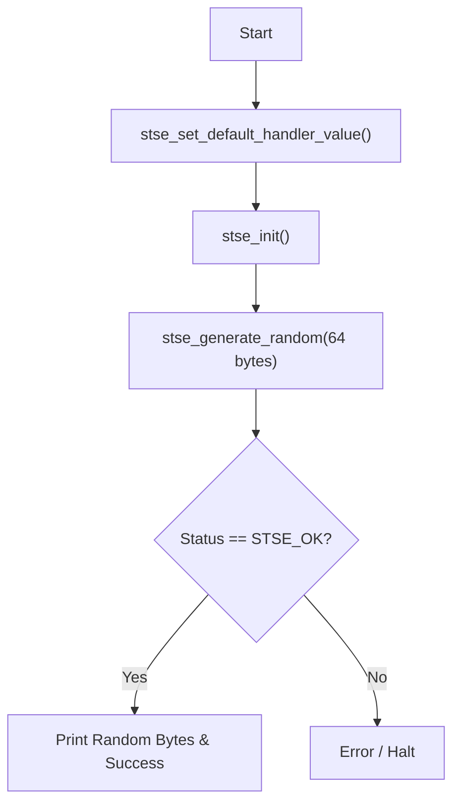

# 01\_Random\_number

## Purpose

Demonstrates the True Random Number Generator (TRNG) embedded in the STSAFE-A110.  The example requests 64 bytes of random data from the device using `stse_generate_random` and prints the result.  Useful for seeding host-side CSPRNGs or verifying the TRNG is accessible.

## Applicative Flowchart



## Architecture

```
01_Random_number  →  libstse.so (stse_generate_random)
                  →  STSELib_Platform IPC proxy
                  →  se-daemon (Unix socket /var/run/se-daemon.sock)
                  →  /dev/i2c-N  →  STSAFE-A110 TRNG
```

## Prerequisites

| Item | Details |
|------|---------|
| Target board | STM32MP1 (OpenSTLinux 6.6) or Raspberry Pi (Raspberry Pi OS) |
| Secure element | STSAFE-A110 at I²C address 0x20 |
| Runtime | `se-daemon` running on target, `libstse.so` installed |
| Build host | OpenSTLinux SDK sourced **or** `CROSS_COMPILE` set |

## Cross-Compile

```bash
# Option A — OpenSTLinux SDK (recommended)
source /opt/st/stm32mp1/<version>/environment-setup-cortexa7t2hf-neon-vfpv4-ostl-linux-gnueabi

# Option B — bare cross-toolchain
export CROSS_COMPILE=arm-ostl-linux-gnueabi-

cd /path/to/stse-linux
make 01_Random_number
# or
make
```

Binary produced at `build/01_Random_number`.

## Deploy

```bash
make deploy TARGET=root@192.168.1.100
```

To copy only the binary:
```bash
scp build/01_Random_number root@192.168.1.100:/home/root/
```

## Install on Target

```bash
ssh root@192.168.1.100 "systemctl enable --now se-daemon"
```

## Execute on Target

```bash
ssh root@192.168.1.100

# Default: uses /dev/i2c-1
./01_Random_number

# Explicit bus
./01_Random_number 5
```

### Expected Output

```
----------------------------------------------------------------------------------------------------------------
-                                  STSAFE-A110 Random number generation example                               -
...
 - stse_generate_random (64 bytes):
   3A F2 91 0C 4B ... (64 random bytes)

Random number generation: SUCCESS
```

## Troubleshooting

| Error | Action |
|-------|--------|
| `stse_init ERROR` | Check I²C bus number and `se-daemon` status |
| `stse_generate_random ERROR` | Check STSAFE-A110 command authorisation configuration |
