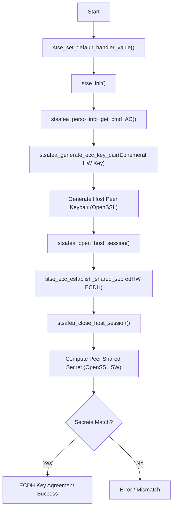

# 03\_ECDH

## Purpose

Demonstrates Elliptic Curve Diffie-Hellman (ECDH) key agreement using the STSAFE-A110.  The example:

1. Generates an ephemeral NIST P-256 key pair on the STSAFE-A110 (`stse_generate_ecc_key_pair`).
2. Generates a peer key pair in software using OpenSSL.
3. Calls `stse_ecc_ecdh` to compute the shared secret on the hardware using the device's private key and the software peer's public key.
4. Independently computes the same shared secret in software using OpenSSL.
5. Compares both results to verify correctness.

The private key never leaves the secure element, making this the recommended approach for TLS session key establishment or any protocol requiring forward secrecy.

## Applicative Flowchart



## Architecture

```
03_ECDH  →  libstse.so (stse_generate_ecc_key_pair, stse_ecc_ecdh)
         →  STSELib_Platform IPC proxy
         →  se-daemon  →  /dev/i2c-N  →  STSAFE-A110
         OpenSSL (peer side, software-only)
```

## Prerequisites

| Item | Details |
|------|---------|
| Target board | STM32MP1 (OpenSTLinux 6.6) or Raspberry Pi (Raspberry Pi OS) |
| Secure element | STSAFE-A110 with a writable ECDH-capable key slot |
| Runtime | `se-daemon` running, `libstse.so` installed, OpenSSL 3.x |
| Build host | OpenSTLinux SDK sourced **or** `CROSS_COMPILE` set |

## Cross-Compile

```bash
source /opt/st/stm32mp1/<version>/environment-setup-cortexa7t2hf-neon-vfpv4-ostl-linux-gnueabi
# or: export CROSS_COMPILE=arm-ostl-linux-gnueabi-

cd /path/to/stse-linux
make 03_ECDH
```

Binary produced at `build/03_ECDH`.

## Deploy

```bash
make deploy TARGET=root@192.168.1.100
# or:
scp build/03_ECDH root@192.168.1.100:/home/root/
```

## Install on Target

```bash
ssh root@192.168.1.100 "systemctl enable --now se-daemon"
```

## Execute on Target

```bash
./03_ECDH          # default /dev/i2c-1
./03_ECDH 5        # use /dev/i2c-5
```

### Expected Output

```
 - Generate ephemeral key pair on STSAFE-A110 ...  OK
 - Generate peer key pair (OpenSSL) ...  OK
 - stse_ecc_ecdh (hardware) shared secret: <32 bytes>
 - OpenSSL ECDH (software) shared secret:  <32 bytes>
 - Shared secrets match

ECDH: SUCCESS
```

## Troubleshooting

| Error | Action |
|-------|--------|
| `stse_ecc_ecdh ERROR` | Key slot not configured for ECDH; check AC and slot type |
| Shared secrets mismatch | Possible bug in public key encoding/decoding; check coordinate byte order |
| `stse_init ERROR` | Check I²C bus and `se-daemon` |
