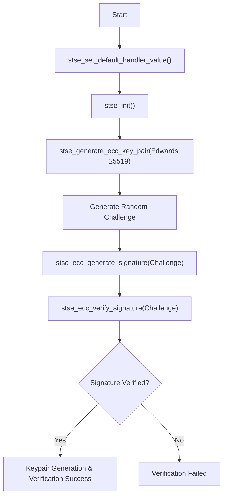

# 01\_Key\_pair\_generation\_EDWARDS\_25519

## Purpose

Generates an Edwards25519 (Ed25519) key pair on the STSAFE-A120.  Ed25519 offers fast signature verification and small 32-byte keys.  The private key is protected in hardware; the public key (32 bytes) is returned and printed.

## Applicative Flowchart



## Architecture

```
01_Key_pair_generation_EDWARDS_25519  →  libstse.so (stse_generate_ecc_key_pair)
                                      →  STSELib_Platform IPC proxy
                                      →  se-daemon  →  /dev/i2c-N  →  STSAFE-A120
```

## Prerequisites

| Item | Details |
|------|---------|
| Target board | STM32MP1 (OpenSTLinux 6.6) or Raspberry Pi (Raspberry Pi OS) |
| Secure element | STSAFE-A120 with a slot configured for Edwards 25519 |
| Runtime | `se-daemon` running, `libstse.so` installed |
| Build host | OpenSTLinux SDK sourced **or** `CROSS_COMPILE` set |

## Cross-Compile

```bash
source /opt/st/stm32mp1/<version>/environment-setup-cortexa7t2hf-neon-vfpv4-ostl-linux-gnueabi
# or: export CROSS_COMPILE=arm-ostl-linux-gnueabi-

cd /path/to/stse-linux
make 01_Key_pair_generation_EDWARDS_25519
```

Binary produced at `build/01_Key_pair_generation_EDWARDS_25519`.

## Deploy

```bash
make deploy TARGET=root@192.168.1.100
# or:
scp build/01_Key_pair_generation_EDWARDS_25519 root@192.168.1.100:/home/root/
```

## Install on Target

```bash
ssh root@192.168.1.100 "systemctl enable --now se-daemon"
```

## Execute on Target

```bash
./01_Key_pair_generation_EDWARDS_25519          # default /dev/i2c-1
./01_Key_pair_generation_EDWARDS_25519 5        # use /dev/i2c-5
```

### Expected Output

```
 - Generate Edwards 25519 key pair on slot 0 ...
 - Public key: <32 bytes>

Key pair generation EDWARDS 25519: SUCCESS
```

## Troubleshooting

| Error | Action |
|-------|--------|
| `stse_generate_ecc_key_pair ERROR` | Ensure the slot is configured for Ed25519 and AC allows key generation |
| `stse_init ERROR` | Check I²C bus and `se-daemon` |
