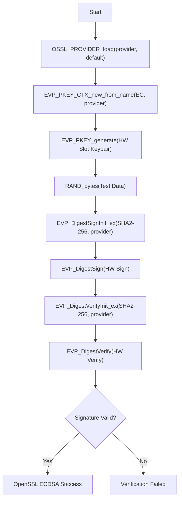

# STSAFE-A120 OpenSSL 3.x Provider ECDSA Example

This example demonstrates how to use standard OpenSSL 3.x EVP APIs with the `stsafe-a120` provider to generate an EC key pair on STSAFE-A120 hardware, sign test data on the secure element, and verify the signature in hardware.

## Prerequisites

- `se-daemon` running on the target board
- `libstse.so` installed
- `stsafe-a120.so` built and path exported in `OPENSSL_MODULES`

## Usage

```bash
export OPENSSL_MODULES=/path/to/provider/dir
./02_OpenSSL_ecdsa_sign_verify [busID [slotID]]
```

## Applicative Flowchart

