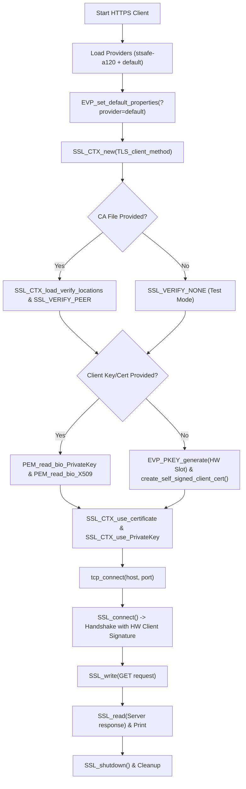

# STSAFE-A OpenSSL 3.x HTTPS Client Example

This example demonstrates how to run an **HTTPS (TLS 1.2 / TLS 1.3) client** on Linux/MPU using OpenSSL 3.x with **STSAFE-A** (STSAFE-A120 / STSAFE-A110) hardware-backed identity.

In addition to standard HTTPS client requests, the client supports **mutual TLS (mTLS)** where the client presents a hardware-protected certificate and computes the `CertificateVerify` digital signature in the STSAFE-A hardware accelerator.

---

## Features

- **Hardware Client Authentication (mTLS)**: Authenticate to an HTTPS/TLS server using an ECC private key stored within the STSAFE-A secure element.
- **On-the-fly Key & Certificate Provisioning**: If client credentials are not passed on the command line, the client automatically generates a key pair in the STSAFE-A and self-signs an identity certificate.
- **Custom CA Verification**: Supports passing a trusted CA certificate file (`ca_file`) to verify the remote HTTPS server, or running in test mode with peer verification disabled.
- **Full HTTP/1.1 Request/Response**: Sends an HTTP/1.1 GET request with custom headers (Host, User-Agent, SNI) and prints the server status code, headers, and body.

---

## Prerequisites

1. `se-daemon` running on the Linux host:
   ```bash
   sudo systemctl start se-daemon
   ```
2. `OPENSSL_MODULES` environment variable set to the directory containing `stsafe-a120.so` (or `stsafe-a110.so`).

---

## Build

```bash
cmake --build build --target 07_OpenSSL_https_client
```

---

## Usage

```bash
export OPENSSL_MODULES=/usr/lib/ossl-modules
./07_OpenSSL_https_client [host] [port] [path] [ca_file] [busID] [slotID] [client_cert] [client_key]
```

### Arguments

| Parameter | Default | Description |
|---|---|---|
| `host` | `localhost` | Server hostname or IP address |
| `port` | `8443` | TCP port number |
| `path` | `/` | HTTP request path (e.g. `/index.html` or `/api/status`) |
| `ca_file` | `(none)` | Path to PEM CA certificate for server verification (disabled if empty) |
| `busID` | `1` | Linux I²C bus number (`/dev/i2c-1`) |
| `slotID` | `1` | STSAFE-A asymmetric private key slot index |
| `client_cert` | `(none)` | Client X.509 certificate file (auto-generated if omitted) |
| `client_key` | `(none)` | Client STSAFE PEM private key (auto-generated if omitted) |

---

## End-to-End Test (Server + Client)

In Terminal 1 (Start Server):
```bash
./07_OpenSSL_https_server 8443 1 1
```

In Terminal 2 (Run Client):
```bash
./07_OpenSSL_https_client localhost 8443 /
```

---

## Applicative Flowchart


