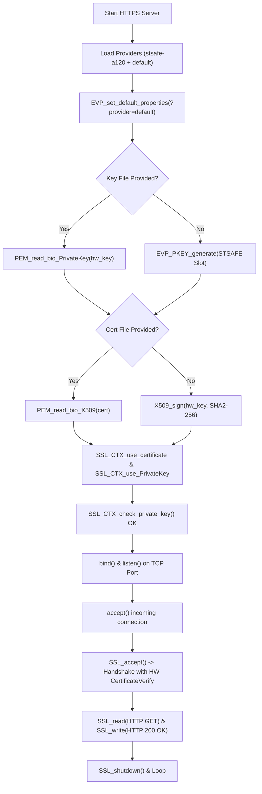

# STSAFE-A OpenSSL 3.x HTTPS Server Example

This example demonstrates how to run an **HTTPS (TLS 1.2 / TLS 1.3) server** on Linux/MPU where the server's private identity key is securely isolated inside the **STSAFE-A** secure element (STSAFE-A120 or STSAFE-A110).

All cryptographic signatures required during the TLS handshake (`CertificateVerify`) are delegated to the STSAFE-A hardware via the OpenSSL 3.x provider (`stsafe-a120.so` or `stsafe-a110.so`), meaning **the server private key never leaves the secure element**.

---

## Features

- **Hardware Private Key Protection**: The server identity key is generated and stored directly in an STSAFE-A key slot (e.g. Slot 1 or factory Slot 0).
- **Automated Self-Signed Certificate Creation**: If no existing certificate file is passed, the server automatically generates a self-signed X.509 certificate and signs it directly using the STSAFE-A hardware key.
- **Support for Pre-Provisioned Certificates & Keys**: Accepts standard PEM certificate chains and hardware-referencing PEM private key files.
- **Full HTTP/1.1 Web Server**: Responds to incoming HTTPS GET requests with an informative HTML page.
- **Clean Fallback to OpenSSL Default Provider**: Ephemeral session key exchange (ECDHE / X25519) and symmetric ciphers (AES-GCM / ChaCha20-Poly1305) run smoothly using OpenSSL's standard software provider.

---

## Prerequisites

1. `se-daemon` running as root:
   ```bash
   sudo systemctl start se-daemon
   # or run manually:
   sudo se-daemon --bus 1
   ```
2. `OPENSSL_MODULES` environment variable set to the directory containing `stsafe-a120.so` (or `stsafe-a110.so`).

---

## Build

From your build directory:
```bash
cmake --build build --target 07_OpenSSL_https_server
```

---

## Usage

```bash
export OPENSSL_MODULES=/usr/lib/ossl-modules
./07_OpenSSL_https_server [port] [busID] [slotID] [cert_file] [key_file]
```

### Arguments

| Parameter | Default | Description |
|---|---|---|
| `port` | `8443` | TCP port to listen on |
| `busID` | `1` | Linux I²C bus number (`/dev/i2c-1`) |
| `slotID` | `1` | STSAFE-A asymmetric private key slot index |
| `cert_file` | `(none)` | Path to X.509 server certificate (auto-generated if omitted) |
| `key_file` | `(none)` | Path to STSAFE-A PEM private key file (auto-generated in slot if omitted) |

### Quick Start Example

Run server on default port 8443:
```bash
./07_OpenSSL_https_server 8443 1 1
```

Test connecting with `curl` or browser from another terminal:
```bash
curl -k https://localhost:8443/
```
*(Use `-k` to accept self-signed certificate, or supply the CA certificate).*

---

## Applicative Flowchart


