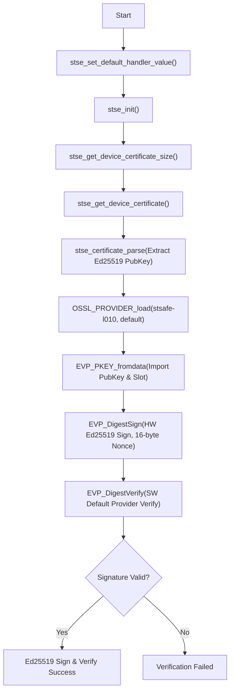

# STSAFE-L010 OpenSSL 3.x Provider Example

This example demonstrates how to use standard OpenSSL 3.x EVP APIs with the `stse` provider to generate an Ed25519 key pair on a STSAFE-L010 secure element, perform a hardware-backed signature, and verify the signature in software using the default provider.

## Usage

```bash
# Set path to the stse.so provider binary
export OPENSSL_MODULES=../../build

# Run the program (optionally specify bus and slot)
./l010_02_OpenSSL_eddsa_sign [busID [slotID]]
```

For example, to run on I2C bus `/dev/i2c-1` and private key slot `0`:
```bash
./l010_02_OpenSSL_eddsa_sign 1 0
```

## How It Works

1. **Provider Load:** Loads both `stse` provider (for hardware keygen/signing) and `default` provider (for software verification).
2. **Key Generation:** Generates an Ed25519 key pair directly on the secure element. The private key remains secure on-chip.
3. **Hardware Sign:** Invokes the one-shot `EVP_DigestSign` function with `provider=stse` context properties to perform signing in hardware.
4. **Software Verify:** Export the public key from the `stse` provider and verify it using standard software cryptographics in the default provider.

## Applicative Flowchart

